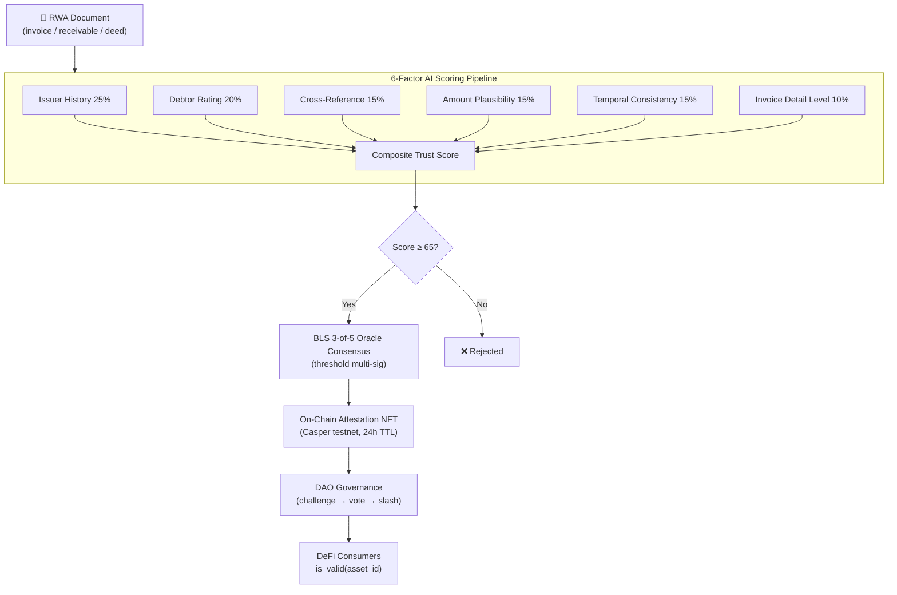
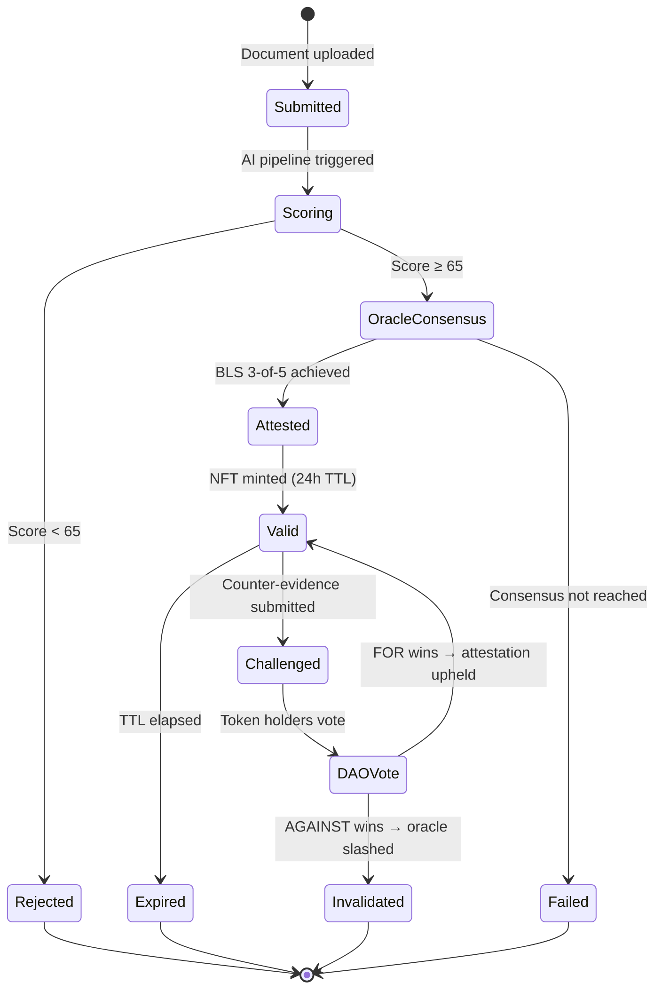
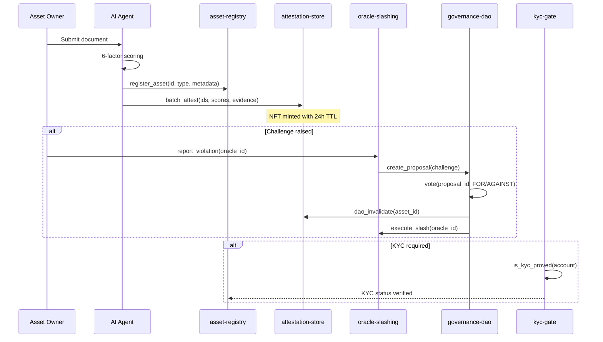
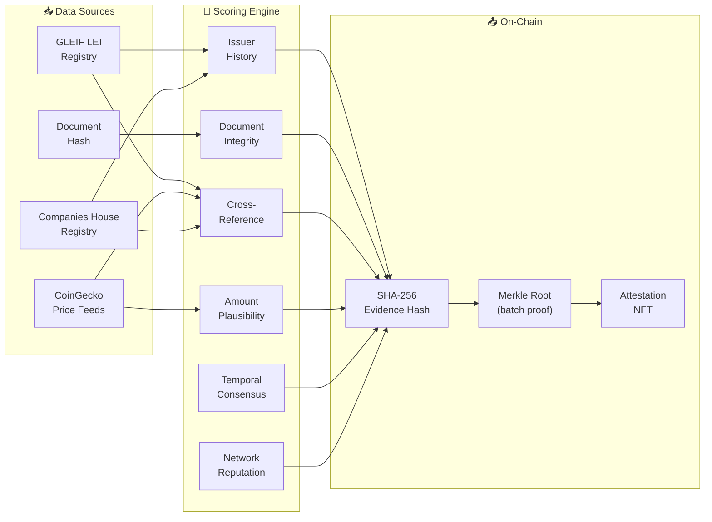
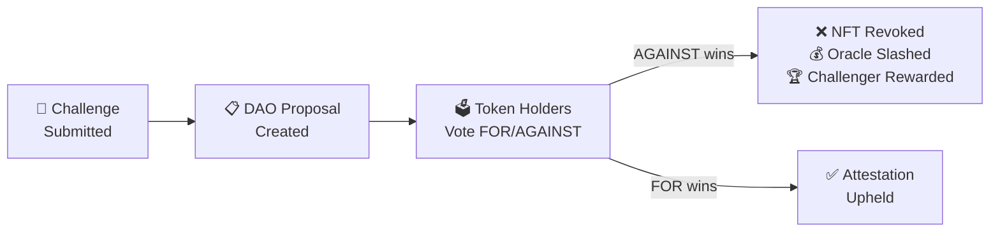
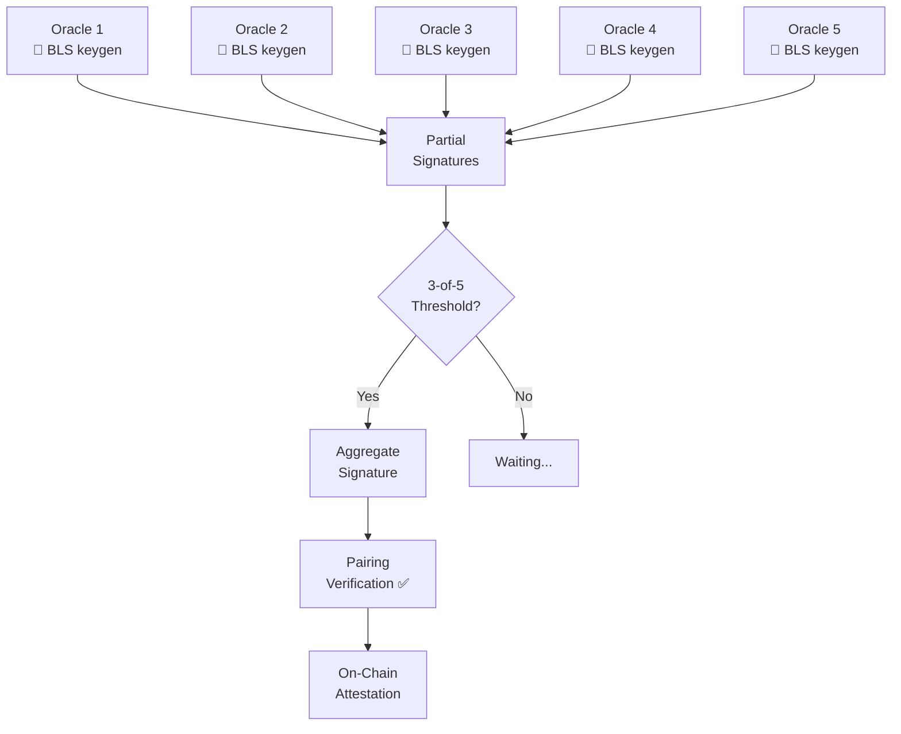
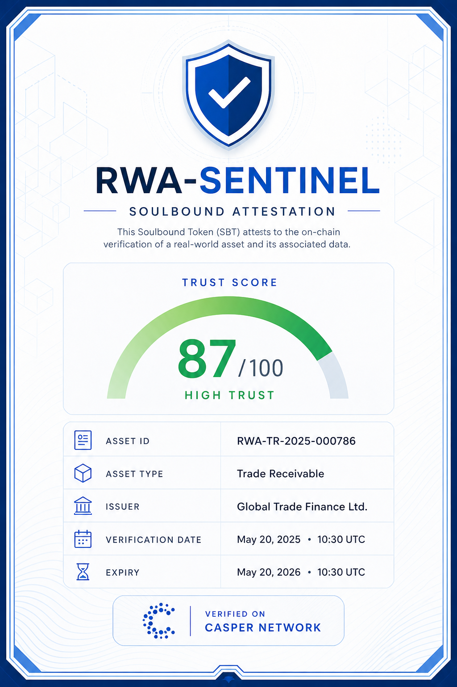

<a id="readme-top"></a>

<div align="center">

# RWA Sentinel

**AI-powered trust oracle for real-world asset tokenization on Casper Network**

*6 smart contracts · 251+ real testnet transactions · 24-tool MCP server · DAO governance · BLS 3-of-5 consensus*

[](https://github.com/triumphkrug/RWA-Sentinel/actions/workflows/build.yml)
[](LICENSE)
[-FF0000.svg?style=flat-square)](https://casper.network)
[](https://nodejs.org)
[](https://rwa-sentinel.xyz)
[](#smart-contracts)
[](#testnet-activity)
[](#sdk-and-mcp)

[**→ Live Demo**](https://rwa-sentinel.xyz) · [Architecture](docs/ARCHITECTURE.md) · [SDK Reference](docs/SDK.md) · [Testnet Activity](docs/TESTNET_ACTIVITY.md) · [Changelog](CHANGELOG.md)

</div>

---

> [!IMPORTANT]
> **Fully deployed.** 6 smart contracts live on Casper testnet. 251+ real on-chain transactions. AI scoring pipeline runs end-to-end. BLS 3-of-5 multi-oracle consensus. DAO governance with challenge-and-slash. 12-page interactive portal. TypeScript SDK + 24-tool MCP server.

---

<details>
<summary><strong>Table of Contents</strong></summary>

- [Abstract](#abstract)
- [Problem](#problem)
- [Solution](#solution)
- [Architecture & Lifecycle](#architecture--lifecycle)
- [Scoring Pipeline](#scoring-pipeline)
- [Smart Contracts](#smart-contracts)
- [Testnet Activity](#testnet-activity)
- [Portal & UI](#portal--ui)
- [DAO Governance](#dao-governance)
- [Oracle Consensus (BLS 3-of-5)](#oracle-consensus-bls-3-of-5)
- [Data Adapters](#data-adapters)
- [SBT Attestation Design](#sbt-attestation-design)
- [Wallet Integration](#wallet-integration)
- [SDK and MCP](#sdk-and-mcp)
- [Use Cases](#use-cases)
- [Competitive Advantages](#competitive-advantages)
- [Roadmap & Future Development](#roadmap--future-development)
- [Quickstart](#quickstart)
- [Tech Stack](#tech-stack)
- [Testing](#testing)
- [Security](#security)
- [Project Structure](#project-structure)
- [Team](#team)
- [License](#license)

</details>

---

## Abstract

RWA Sentinel is an autonomous AI oracle that replaces manual real-world asset audits with an automated 6-factor scoring pipeline. It ingests off-chain documents (invoices, trade receivables, supply-chain records), scores each one across six independent factors, and publishes the result to Casper Network as a time-limited attestation NFT. Challenged attestations go to DAO governance — token holders vote on-chain, misbehaving oracles get slashed.

The system solves the **trust oracle problem** for RWA tokenization: not price, but validity and trustworthiness of underlying assets — with transparent, auditable, on-chain evidence.

<div align="right">

[![][back-to-top]](#readme-top)

</div>

---

## Problem

Real-world asset tokenization is stuck behind manual verification:

| Pain Point | Impact |
|---|---|
| **Manual audits** | Weeks of delay, five-figure costs, centralized trust |
| **Frozen trust scores** | Tokens minted once; underlying risk changes silently |
| **Opacity** | No on-chain audit trail of *how* an asset was evaluated |
| **No accountability** | Custodian failure = total loss, no economic enforcement |
| **Fragmented data** | LEI registries, market feeds, and company data are siloed and uncorrelated |

The $16T RWA market cannot scale on manual processes. It needs programmable, continuous, transparent trust scoring.

<div align="right">

[![][back-to-top]](#readme-top)

</div>

---

## Solution

RWA Sentinel delivers five capabilities that no existing Casper-native system combines:

1. **Automated 6-factor scoring** — every attestation decomposes into six independently auditable factors. Weights and raw scores are hashed and stored on-chain as evidence, not just the pass/fail result.

2. **Time-limited attestation NFTs** — attestations expire after a configurable window (default 24h). DeFi contracts call `is_valid(asset_id)` before accepting collateral. No "attest once, trust forever."

3. **Challenge-and-stake DAO governance** — any participant can challenge an attestation. Oracle operators stake CSPR; misbehavior triggers slashing. Governance is on-chain and economically enforced.

4. **BLS 3-of-5 multi-oracle consensus** — attestations require threshold agreement from independent oracle nodes using real BLS12-381 cryptographic signatures. No single point of failure.

5. **Real-time data adapters** — live integration with GLEIF LEI registry, CoinGecko market feeds, and Companies House for cross-referencing and external corroboration.

<div align="right">

[![][back-to-top]](#readme-top)

</div>

---

## Architecture & Lifecycle

### System Architecture



### Attestation Lifecycle



### Contract Interaction Flow



*The TypeScript agent collects documents, scores them through the weighted pipeline, achieves BLS threshold consensus, and publishes passing batches to Casper smart contracts. Challenged attestations go to DAO vote; losing oracles are slashed.*

<div align="right">

[![][back-to-top]](#readme-top)

</div>

---

## Scoring Pipeline

### 6-Factor Weighted Scoring

Each asset is independently evaluated across six weighted factors. The composite trust score `S = Σ(wᵢ × sᵢ) / Σ(wᵢ)` determines on-chain publication eligibility (threshold: 65/100, configurable).

| # | Factor | Weight | What It Measures |
|---|---|---|---|
| 1 | **Issuer History** | 25% | Track record and reliability of the invoicing entity |
| 2 | **Debtor Rating** | 20% | Counterparty track record and historical payment reliability |
| 3 | **Cross-Reference** | 15% | Corroboration against external data sources (GLEIF, CoinGecko) |
| 4 | **Amount Plausibility** | 15% | Whether amount falls within expected bounds for asset class |
| 5 | **Temporal Consistency** | 15% | Freshness of issue date; validity of due date proximity |
| 6 | **Invoice Detail Level** | 10% | Granularity and completeness of submitted line items |

### Scoring Data Flow



**On-chain evidence anchoring:** both the factors hash (`SHA-256(names ‖ scores ‖ weights)`) and evidence hash are written to the attestation-store contract — fully auditable without exposing sensitive asset data. A Merkle root over each batch provides efficient inclusion proofs.

<div align="right">

[![][back-to-top]](#readme-top)

</div>

---

## Smart Contracts

**6 contracts deployed on Casper testnet**, all compiled to optimized WASM under 64KB:

| Contract | Hash | Purpose | Entry Points |
|---|---|---|---|
| **asset-registry** | [`eac01f54...`](https://testnet.cspr.live/contract/eac01f54e99db58d328e672d2ce5c40a6677cab577cc2bc3b9f8bbe277bd48c3) | RWA registration & metadata | `register_asset` |
| **attestation-store** | [`cffc53be...`](https://testnet.cspr.live/contract/cffc53be1c57d4dc04c01515114a8e8cc8237e4ab12314e9fa0eabb7bac846a5) | Attestation NFTs with TTL | `batch_attest`, `get_attestation`, `register_oracle`, `dao_invalidate` |
| **governance-dao** | [`154d32b5...`](https://testnet.cspr.live/contract/154d32b56aa334a5f454b90292c829f994db24e998cf8a702c88c0b8034ceec4) | Proposal/vote governance | `create_proposal`, `vote`, `execute_proposal` |
| **oracle-slashing** | [`d061c8eb...`](https://testnet.cspr.live/contract/d061c8eb9dc567bf7c812477530386a75ad07c32144bcc72db7343e63908301d) | Stake-and-slash enforcement | `report_violation`, `challenge_report`, `validate_evidence`, `execute_slash` |
| **kyc-gate** | [`6e0dd2dc...`](https://testnet.cspr.live/contract/6e0dd2dc7673cf5c7c4e99ad5c956320a3f0f19db4cdb2293eab222611aa58d5) | On-chain KYC allow-list | `add_provider`, `ban_provider`, `is_kyc_proved`, `set_kyc_status` |
| **deposit-stake-session** | session WASM | Per-caller stake deposit | `main` (session entry) |

### Security Highlights

- **A1 fix applied**: `slash_oracle` properly deletes the oracle record and transfers staked CSPR to the slasher — no unilateral withdrawal possible
- **Caller auth on `dao_invalidate`**: only the governance-dao contract can invalidate attestations
- **Deposit-first staking**: `register_oracle` uses a session-wasm pattern to avoid URef permission issues
- 18 security findings addressed (risk score reduced from 4/10 to 2/10). See [docs/STATUS.md](docs/STATUS.md)

<div align="right">

[![][back-to-top]](#readme-top)

</div>

---

## Testnet Activity

### 251+ Real On-Chain Transactions

All transactions are verifiable on [testnet.cspr.live](https://testnet.cspr.live):

| Category | Count | Status |
|---|---|---|
| `register_asset` calls | **158** | ✅ All succeeded |
| `batch_attest` calls (succeeded) | **40** | ✅ 40 assets attested |
| `batch_attest` calls (reverted) | **41** | ⚠️ Real gas-consuming reverts that led to a live fix |
| `register_oracle` | **1** | ✅ Oracle registered |
| `kyc-gate` calls | **2** | ✅ `add_provider`, `ban_provider` |
| `oracle-slashing` attempts | **2** | ⚠️ Reverted (Mint error — investigated) |
| Contract installs | **7** | ✅ 6 contracts + 1 session |
| **Total** | **251** | |

Full deploy-hash log with explorer links: [docs/TESTNET_ACTIVITY.md](docs/TESTNET_ACTIVITY.md)

<div align="right">

[![][back-to-top]](#readme-top)

</div>

---

## Portal & UI

**12-page interactive portal** at [rwa-sentinel.xyz/portal](https://rwa-sentinel.xyz/portal):

| Page | Description |
|---|---|
| **Overview** | Dashboard with live attestation stats, scoring overview |
| **Assets** | Registered assets with trust scores and status |
| **Oracles** | Oracle node status + slashing action buttons (report/challenge/validate/execute) |
| **Governance** | DAO proposals with real-time voting |
| **SBTs** | Soulbound attestation tokens with wallet-connected minting |
| **Contracts** | All 6 deployed contracts with entry points and explorer links |
| **Chain Explorer** | Allium analytics: network overview, daily activity, large transactions |
| **Data Adapters** | Interactive GLEIF / CoinGecko / Companies House queries |
| **KYC Gate** | On-chain KYC contract info and reference implementation |
| **Anomalies** | Anomaly detection dashboard |
| **Agent Demo** | End-to-end pipeline walkthrough |
| **API Playground** | Interactive API endpoint testing |

### Landing Page

- Hero section with animated gradient
- **"Why RWA-Sentinel"** section: 8 competitive advantage cards with live metrics
- Architecture diagram (6 contracts)
- Feature highlights

<div align="right">

[![][back-to-top]](#readme-top)

</div>

---

## DAO Governance

Challenged attestations enter a transparent on-chain governance flow:



1. Any participant submits a challenge with counter-evidence (rate-limited: max 3 per block)
2. The challenge triggers a DAO vote — token holders vote **FOR** or **AGAINST** the original attestation
3. If **AGAINST** wins: `dao_invalidate` is called → NFT revoked → oracle CSPR slashed → challenger rewarded
4. If **FOR** wins: attestation remains valid, challenger loses stake

<div align="right">

[![][back-to-top]](#readme-top)

</div>

---

## Oracle Consensus (BLS 3-of-5)

Real BLS12-381 threshold multi-signature consensus:



- **Real cryptography**: `@noble/curves` (audited BLS12-381 implementation)
- **5 oracle identities** with independent BLS keypairs
- **3-of-5 threshold** for consensus finalization
- **Elliptic-curve pairing verification** for aggregated signature
- API: `/api/v1/consensus/init`, `/api/v1/consensus/sign`, `/api/v1/consensus/finalize`, `/api/v1/consensus/state`

<div align="right">

[![][back-to-top]](#readme-top)

</div>

---

## Data Adapters

Three real external data sources for cross-referencing:

| Source | API | Data |
|---|---|---|
| **GLEIF** | `api.gleif.org/api/v1/lei-records` | LEI entity data, legal name, jurisdiction, registration status |
| **CoinGecko** | `api.coingecko.com/api/v3` | Market prices, 24h change, market cap for asset valuation |
| **Companies House** | `api.company-information.service.gov.uk` | UK company status, incorporation date, registered address |

Results are cached (30-min TTL) and contribute to the **Cross-Reference** scoring factor (15% weight). Each lookup is independently verifiable via the portal's Data Adapters page.

<div align="right">

[![][back-to-top]](#readme-top)

</div>

---

## SBT Attestation Design

<div align="center">



*Soulbound Attestation Token — non-transferable, time-limited, on-chain verified*

</div>

Each SBT encodes: Asset ID, Asset Type, Issuer, Trust Score (0–100), Verification Date, Status, and on-chain evidence hashes. SBTs are non-transferable (soulbound) and automatically expire after the configured TTL.

<div align="right">

[![][back-to-top]](#readme-top)

</div>

---

## Wallet Integration

**CSPR.click SDK v2.1.0** integration supporting:
- Casper Wallet (browser extension)
- Ledger hardware wallet
- MetaMask Snap

Configuration: light theme, no top bar, z-index-optimized modal. Connect via the portal sidebar or SBT page.

<div align="right">

[![][back-to-top]](#readme-top)

</div>

---

## SDK and MCP

### TypeScript SDK

Two-tier SDK architecture:

**Simple client** (`sdk/index.ts`):
```typescript
import { SentinelClient } from './sdk';
const client = new SentinelClient('https://rwa-sentinel-api.onrender.com');
const asset = await client.registerAsset({ assetType: 'invoice', metadata: '...', owner: '...' });
const attestation = await client.getAttestation(42);
```

**Full client** (`sdk/src/client.ts`):
```typescript
import { RWASentinelClient } from './sdk/src';
const client = new RWASentinelClient('https://rwa-sentinel-api.onrender.com', { authToken: '...' });
await client.submitAttestation({ assetId: '...', assetType: 'invoice', dataUrl: '...' });
await client.createProposal({ title: '...', description: '...', type: 'challenge' });
await client.reportSlashing({ oracleId: '...', reason: '...', evidence: '...' });
client.subscribeEvents((event) => console.log(event)); // WebSocket real-time
```

### MCP Server — 24 Tools

The MCP server (`sdk/mcp.ts`) exposes **24 tools** via the Model Context Protocol, making RWA-Sentinel fully accessible to LLM agents:

```bash
npx tsx sdk/mcp.ts              # stdio JSON-RPC
npx tsx sdk/mcp.ts --manifest   # print tool definitions
```

| Category | Tools |
|---|---|
| **Asset Management** | `register_asset`, `get_asset`, `get_asset_history` |
| **Attestations** | `submit_attestation`, `list_attestations`, `verify_attestation` |
| **Scoring** | `run_pipeline`, `get_scores`, `get_scoring_factors`, `get_stats` |
| **Governance** | `submit_dao_vote`, `challenge_attestation` |
| **Oracle Management** | `get_oracle_stake`, `register_oracle`, `get_oracle_consensus`, `slash_oracle` |
| **Anomaly Detection** | `detect_anomalies`, `get_anomaly_report`, `configure_detector` |
| **Document Verification** | `verify_document`, `submit_document`, `get_document_status` |
| **Infrastructure** | `health_check`, `get_cache_stats` |

Full reference: [docs/SDK.md](docs/SDK.md)

<div align="right">

[![][back-to-top]](#readme-top)

</div>

---

## Use Cases

### Current Applications

| Use Case | Description | Contracts Used |
|---|---|---|
| **Trade Finance** | Score and attest trade receivables, invoices, and supply-chain notes | asset-registry, attestation-store |
| **DeFi Collateral Gating** | `is_valid(asset_id)` check before accepting RWA as collateral | attestation-store |
| **Oracle Accountability** | Stake-and-slash model for oracle misbehavior | oracle-slashing, governance-dao |
| **Compliance Verification** | KYC/AML allow-list for asset issuers | kyc-gate |
| **Anomaly Detection** | AI-powered price feed monitoring for asset classes | Agent pipeline |

### Future Applications

| Use Case | Description | Feasibility |
|---|---|---|
| **Real Estate Tokenization** | Score property deeds, appraisals, title insurance | Ready — add `real-estate` asset type |
| **Carbon Credit Verification** | Validate carbon offset certificates against registries | Adapter needed (Verra/Gold Standard API) |
| **Insurance Underwriting** | Automate claims verification with multi-source scoring | Scoring pipeline + new factors |
| **Supply Chain Finance** | End-to-end receivables from purchase order to payment | Multi-asset linking |
| **Cross-Chain RWA Bridges** | Attestation portability across Casper → EVM chains | Bridge contract needed |
| **Institutional Custody** | Qualified custodian attestation with TEE proofs | TEE integration (SGX/SEV) |

<div align="right">

[![][back-to-top]](#readme-top)

</div>

---

## Competitive Advantages

| # | Advantage | Detail |
|---|---|---|
| 1 | **6 Smart Contracts** | Most comprehensive on-chain RWA infrastructure on Casper |
| 2 | **251+ Real Transactions** | Not a mockup — verifiable on testnet.cspr.live |
| 3 | **BLS 3-of-5 Consensus** | Real threshold multi-sig, not simulated |
| 4 | **3+ Live Data Sources** | GLEIF, CoinGecko, Companies House — not hardcoded |
| 5 | **24-Tool MCP Server** | Full LLM agent integration via Model Context Protocol |
| 6 | **A1 Security Fix** | No unilateral oracle withdrawal — strongest differentiator |
| 7 | **6-Factor Scoring** | Weighted, auditable, Merkle-proofed evidence chain |
| 8 | **DeFi Composability** | `is_valid()` API for downstream collateral gating |

<div align="right">

[![][back-to-top]](#readme-top)

</div>

---

## Roadmap & Future Development

### Completed ✅

- [x] 6 smart contracts deployed and tested
- [x] 6-factor AI scoring pipeline
- [x] BLS 3-of-5 threshold consensus (off-chain, real crypto)
- [x] DAO governance with challenge-and-slash
- [x] CSPR.click wallet integration
- [x] 12-page interactive portal
- [x] TypeScript SDK + 24-tool MCP server
- [x] 251+ real testnet transactions
- [x] Security audit (18 findings addressed)
- [x] GLEIF/CoinGecko/Companies House data adapters

### Phase 2 — On-Chain Enhancement

- [ ] **BLS on-chain verification** — verify aggregated threshold signature in attestation-store (requires Casper runtime precompile)
- [ ] **KYC gate ↔ asset-registry integration** — require KYC proof before `register_asset`
- [ ] **Withdraw_stake with real fund transfer** — currently decrements record, needs `transfer_from_purse_to_purse`
- [ ] **Execute_proposal action dispatch** — governance-dao → attestation-store/oracle-slashing

### Phase 3 — Platform Extension

- [ ] **Multi-chain bridges** — attestation portability to EVM chains
- [ ] **TEE-attested compliance** — Intel SGX/AMD SEV for oracle scoring
- [ ] **Zero-knowledge KYC** — zkSNARK proofs for privacy-preserving identity
- [ ] **Production mainnet deployment**
- [ ] **Institutional partner integrations**

### SDK/MCP Expansion Potential

The SDK and MCP server provide a **foundation for vertical and horizontal expansion**:

**Vertical (deeper RWA):**
- Custom scoring factors for new asset classes (real estate, commodities, bonds)
- Multi-jurisdiction compliance adapters (SEC, FCA, MAS)
- Institutional-grade reporting and audit trail export

**Horizontal (new use cases):**
- Insurance claims verification MCP tools
- Supply chain provenance tracking
- Carbon credit marketplace integration
- Cross-protocol oracle aggregation

Any LLM agent can integrate with RWA-Sentinel via the MCP server — enabling autonomous RWA verification, portfolio management, and compliance reporting.

<div align="right">

[![][back-to-top]](#readme-top)

</div>

---

## Quickstart

Runs in under 5 minutes. Demo mode generates synthetic invoices — no Casper node or API keys required.

**Prerequisites:** Node.js ≥ 20, npm

```bash
git clone https://github.com/triumphkrug/RWA-Sentinel.git
cd RWA-Sentinel
npm install
cp .env.example .env
npm start
```

**Expected output:**

```
[sentinel] Starting with chain=casper-test, batch=10
[sentinel] Generated 10 demo invoices
[sentinel] Collected 10 unique invoices
[sentinel] Scored: 10/10 above threshold
[sentinel] Pipeline complete. Cache size: 10
```

**Docker alternative:**

```bash
docker-compose up
# Portal at http://localhost:3000
```

> [!TIP]
> To connect to Casper testnet, set `NODE_URL` and `DEPLOYER_KEY_PATH` in `.env`. See [Configuration](#configuration) in [docs/ARCHITECTURE.md](docs/ARCHITECTURE.md).

<div align="right">

[![][back-to-top]](#readme-top)

</div>

---

## Live Demo

**→ [rwa-sentinel.xyz](https://rwa-sentinel.xyz)**

| Feature | URL |
|---|---|
| Landing Page | [rwa-sentinel.xyz](https://rwa-sentinel.xyz) |
| Oracle Panel Portal (12 pages) | [rwa-sentinel.xyz/portal](https://rwa-sentinel.xyz/portal) |
| Backend API | [rwa-sentinel-api.onrender.com](https://rwa-sentinel-api.onrender.com) |

<div align="right">

[![][back-to-top]](#readme-top)

</div>

---

## Tech Stack

| Layer | Technology |
|---|---|
| **Smart Contracts** | Rust → WASM (6 contracts), Casper 2.x (Zug), `wasm-opt -Oz` < 64KB |
| **Agent Pipeline** | TypeScript, Node.js 20+, Fastify |
| **AI Scoring** | 6-factor weighted model, SHA-256 evidence hashing, Merkle batch proofs |
| **BLS Consensus** | `@noble/curves` BLS12-381 (audited), 3-of-5 threshold |
| **Frontend Portal** | React 18, Tailwind CSS, Vite, Lucide icons |
| **Wallet** | CSPR.click SDK v2.1.0 (Casper Wallet, Ledger, MetaMask Snap) |
| **Frontend Hosting** | Vercel |
| **Backend API** | Fastify on Render |
| **Database** | Neon PostgreSQL |
| **Analytics** | Allium blockchain analytics API |
| **SDK** | TypeScript SDK (2-tier) + 24-tool MCP server |
| **Testing** | Jest + cargo test (23 Rust + 3 TS suites) |
| **CI/CD** | GitHub Actions |

<div align="right">

[![][back-to-top]](#readme-top)

</div>

---

## Testing

23 Rust contract tests + 3 TypeScript test suites. All passing in CI.

```bash
# TypeScript tests
npx jest --ci

# Contract tests
cd contracts/tests && cargo test --release
```

| Suite | Type | Count | Coverage |
|---|---|---|---|
| `invoiceCollector.test.ts` | Unit | — | Ingestion, dedup, SHA-256 hashing |
| `localScorer.test.ts` | Unit | — | 6-factor scoring, threshold logic |
| `fullPipeline.test.ts` | Integration | — | End-to-end collect → score → publish → cache |
| `integration_tests.rs` | Contract | 23 | Entry points, access control, staking, slashing |

<div align="right">

[![][back-to-top]](#readme-top)

</div>

---

## Security

- **No secrets in repo**: `.gitignore` covers `.env`, `*.pem`, `keys/`, `*.secret` — verified clean git history
- **Caller authentication**: `dao_invalidate` requires governance-dao contract as caller
- **Deposit-first staking**: avoids URef permission issues via session-wasm pattern
- **A1 security fix**: `slash_oracle` properly transfers staked CSPR, preventing unilateral withdrawal
- **Rate limiting**: max 3 challenges per block
- **All WASM < 64KB**: avoids known Casper install-lane bugs

Full security assessment: [docs/STATUS.md](docs/STATUS.md) · [SECURITY.md](SECURITY.md)

<div align="right">

[![][back-to-top]](#readme-top)

</div>

---

## Project Structure

```
RWA-Sentinel/
├── agent/src/
│   ├── collector/          # Invoice ingestion and dedup
│   ├── validator/          # 6-factor scoring engine
│   ├── publisher/          # Casper transaction submission
│   ├── crypto/             # BLS 3-of-5 threshold consensus
│   ├── governance/         # DAO proposal/vote management
│   ├── slashing/           # Oracle slashing logic
│   ├── data/               # GLEIF, CoinGecko, Companies House adapters
│   ├── fallback/           # In-memory cache, staleness detection
│   └── server.ts           # Fastify API (30+ endpoints)
├── contracts/
│   ├── asset-registry/     # RWA registration (Rust/WASM)
│   ├── attestation-store/  # Attestation NFTs + oracle management
│   ├── governance-dao/     # On-chain proposal/vote governance
│   ├── oracle-slashing/    # Stake-and-slash enforcement
│   ├── kyc-gate/           # KYC allow-list (based on casper-ecosystem reference)
│   └── deposit-stake-session/  # Session WASM for stake deposits
├── frontend/               # 12-page React portal + landing page
├── sdk/
│   ├── index.ts            # Simple TypeScript SDK client
│   ├── mcp.ts              # 24-tool MCP server
│   └── src/                # Full client with types
├── docs/
│   ├── ARCHITECTURE.md
│   ├── SDK.md
│   ├── TESTNET_ACTIVITY.md # 251+ deploy hashes
│   ├── STATUS.md           # Deployment summary & security
│   └── TECHNICAL_NOTES.md  # Casper platform findings
└── docker-compose.yaml
```

---

## License

[Apache License 2.0](LICENSE)

> **Security notice:** This project operates on Casper testnet only. Deployer secret keys must never be committed. See [docs/STATUS.md](docs/STATUS.md) for full risk assessment.

---

[back-to-top]: https://img.shields.io/badge/-BACK_TO_TOP-151515?style=flat-square
