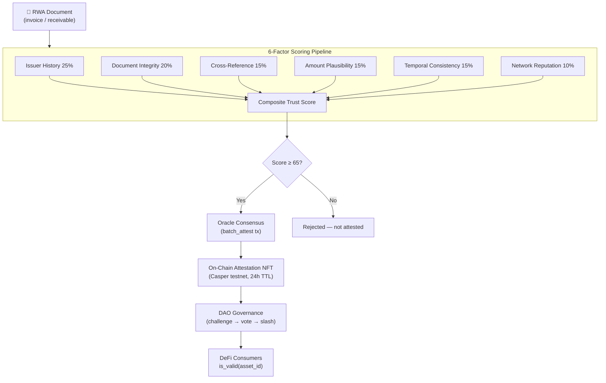

<a id="readme-top"></a>

<div align="center">

# RWA Sentinel

**AI-powered trust oracle for real-world asset tokenization on Casper Network**

*Automated 6-factor scoring · On-chain attestation NFTs · DAO governance*

[](https://github.com/triumphkrug/RWA-Sentinel/actions/workflows/build.yml)
[](LICENSE)
[-FF0000.svg?style=flat-square)](https://casper.network)
[](https://nodejs.org)
[](https://rwa-sentinel.xyz)

[**→ Live Demo**](https://rwa-sentinel.xyz) · [Architecture](docs/ARCHITECTURE.md) · [SDK Reference](docs/SDK.md) · [Changelog](CHANGELOG.md)

</div>

---

> [!IMPORTANT]
> **Fully deployed.** Two smart contracts live on Casper testnet (asset-registry + attestation-store). The 6-factor AI scoring pipeline runs end-to-end. DAO vote panel.

---

<details>
<summary><strong>Table of Contents</strong></summary>

- [Abstract](#abstract)
- [Problem](#problem)
- [Solution](#solution)
- [Architecture](#architecture)
- [6-Factor Scoring](#6-factor-scoring)
- [DAO Governance](#dao-governance)
- [Quickstart](#quickstart)
- [Live Demo](#live-demo)
- [Smart Contracts](#smart-contracts)
- [Tech Stack](#tech-stack)
- [Testing](#testing)
- [SDK and MCP](#sdk-and-mcp)
- [Project Structure](#project-structure)
- [Team](#team)
- [License](#license)

</details>

---

## Abstract

RWA Sentinel is an autonomous AI oracle that replaces manual real-world asset audits with an automated 6-factor scoring pipeline. It ingests off-chain documents (invoices, trade receivables, supply-chain records), scores each one across six independent factors, and publishes the result to Casper Network as a time-limited attestation NFT. Challenged attestations go to DAO governance — token holders vote on-chain, misbehaving oracles get slashed.

The system solves the **trust oracle problem** for RWA tokenization: not price, but validity and trustworthiness of underlying assets — with transparent, auditable, on-chain evidence.

<div align="right">

[![][back-to-top]](#readme-top)

</div>

---

## Problem

Real-world asset tokenization is stuck behind manual verification:

| Pain Point | Impact |
|---|---|
| **Manual audits** | Weeks of delay, five-figure costs, centralized trust |
| **Frozen trust scores** | Tokens minted once; underlying risk changes silently |
| **Opacity** | No on-chain audit trail of *how* an asset was evaluated |
| **No accountability** | Custodian failure = total loss, no economic enforcement |

The $16T RWA market cannot scale on manual processes. It needs programmable, continuous, transparent trust scoring.

<div align="right">

[![][back-to-top]](#readme-top)

</div>

---

## Solution

RWA Sentinel delivers three capabilities that no existing Casper-native system combines:

1. **Automated 6-factor scoring** — every attestation decomposes into six independently auditable factors. Weights and raw scores are hashed and stored on-chain as evidence, not just the pass/fail result.

2. **Time-limited attestation NFTs** — attestations expire after a configurable window (default 24h). DeFi contracts call `is_valid(asset_id)` before accepting collateral. No "attest once, trust forever."

3. **Challenge-and-stake DAO governance** — any participant can challenge an attestation. Oracle operators stake CSPR; misbehavior triggers slashing. Governance is on-chain and economically enforced.

<div align="right">

[![][back-to-top]](#readme-top)

</div>

---

## Architecture



*The TypeScript agent collects documents, scores them through the weighted pipeline, and publishes passing batches to Casper smart contracts. Challenged attestations go to DAO vote; losing oracles are slashed. Downstream DeFi queries attestation validity before accepting RWA collateral.*

Full diagrams: [docs/ARCHITECTURE.md](docs/ARCHITECTURE.md)

<div align="right">

[![][back-to-top]](#readme-top)

</div>

---

## 📸 Screenshots

| Homepage — scoring overview | Oracle portal | DAO vote panel | Attestation detail |
|---|---|---|---|
|  |  |  |  |

> Live at [rwa-sentinel.xyz](https://rwa-sentinel.xyz) · [rwa-sentinel.xyz/portal](https://rwa-sentinel.xyz/portal)

<div align="right">

[![][back-to-top]](#readme-top)

</div>

---

## 6-Factor Scoring

Each asset is independently evaluated across six weighted factors. The composite trust score `S = Σ(wᵢ × sᵢ) / Σ(wᵢ)` determines on-chain publication eligibility (threshold: 65/100, configurable).

| # | Factor | Weight | What It Measures |
|---|---|---|---|
| 1 | **Issuer History** | 25% | Track record and reliability of the invoicing entity |
| 2 | **Document Integrity** | 20% | Hash consistency and tamper-evidence of submitted document |
| 3 | **Cross-Reference** | 15% | Corroboration against external data sources |
| 4 | **Amount Plausibility** | 15% | Whether amount falls within expected bounds for asset class |
| 5 | **Temporal Consistency** | 15% | Freshness of issue date; validity of due date proximity |
| 6 | **Network Reputation** | 10% | On-chain wallet history and prior attestation record |

**On-chain evidence anchoring:** both the factors hash (`SHA-256(names ‖ scores ‖ weights)`) and evidence hash are written to the attestation-store contract — fully auditable without exposing sensitive asset data.

<div align="right">

[![][back-to-top]](#readme-top)

</div>

---

## DAO Governance

Challenged attestations enter a transparent on-chain governance flow:

1. Any participant submits a challenge with counter-evidence (rate-limited: max 3 per block)
2. The challenge triggers a DAO vote — token holders vote **FOR** or **AGAINST** the original attestation
3. If **AGAINST** wins: `dao_invalidate` is called → NFT revoked → oracle CSPR slashed → challenger rewarded
4. If **FOR** wins: attestation remains valid, challenger loses stake

The Oracle Panel portal exposes the live DAO vote panel with one-click FOR/AGAINST voting and real-time toast notifications.

<div align="right">

[![][back-to-top]](#readme-top)

</div>

---

## Quickstart

Runs in under 5 minutes. Demo mode generates synthetic invoices — no Casper node or API keys required.

**Prerequisites:** Node.js ≥ 20, npm

```bash
git clone https://github.com/triumphkrug/RWA-Sentinel.git
cd RWA-Sentinel
npm install
cp .env.example .env
npm start
```

**Expected output:**

```
[sentinel] Starting with chain=casper-test, batch=10
[sentinel] Generated 10 demo invoices
[sentinel] Collected 10 unique invoices
[sentinel] Scored: 10/10 above threshold
[sentinel] Pipeline complete. Cache size: 10
```

**Docker alternative:**

```bash
docker-compose up
# Portal at http://localhost:3000
```

> [!TIP]
> To connect to Casper testnet, set `NODE_URL` and `DEPLOYER_KEY_PATH` in `.env`. See [Configuration](#configuration) in [docs/ARCHITECTURE.md](docs/ARCHITECTURE.md).

*Last verified: 2026-06-30 · [commit history](https://github.com/triumphkrug/RWA-Sentinel/commits/main)*

<div align="right">

[![][back-to-top]](#readme-top)

</div>

---

## Live Demo

**→ [rwa-sentinel.xyz](https://rwa-sentinel.xyz)**

| Feature | URL |
|---|---|
| Oracle Panel Portal | [rwa-sentinel.xyz/portal](https://rwa-sentinel.xyz/portal) |
| DAO Vote Panel | [rwa-sentinel.xyz/portal](https://rwa-sentinel.xyz/portal) (scroll to DAO section) |
| Trust Score Table | [rwa-sentinel.xyz/portal](https://rwa-sentinel.xyz/portal) |
| Backend API | [rwa-sentinel-api.onrender.com](https://rwa-sentinel-api.onrender.com) |

<div align="right">

[![][back-to-top]](#readme-top)

</div>

---

## Smart Contracts

Both deployed on Casper testnet.

| Contract | Hash | Testnet Explorer |
|---|---|---|
| **asset-registry** | `eac01f54...` | [View on cspr.live](https://testnet.cspr.live/contract/eac01f54e99db58d328e672d2ce5c40a6677cab577cc2bc3b9f8bbe277bd48c3) |
| **attestation-store** | `53c9e877...` | [View on cspr.live](https://testnet.cspr.live/contract/53c9e87755a94e1b1efe38e23c83a50f6ffe77e200937dd0c1f923fe2976dce8) |

Key entry points: `register_asset`, `batch_attest`, `get_attestation`, `challenge`, `stake_oracle`, `slash_oracle`, `dao_invalidate`, `invalidate_nft`.

Security: 18 findings addressed (risk score reduced from 4/10 to 2/10). See [docs/KNOWN_LIMITATIONS.md](docs/KNOWN_LIMITATIONS.md).

<div align="right">

[![][back-to-top]](#readme-top)

</div>

---

## Tech Stack

| Layer | Technology |
|---|---|
| **Smart Contracts** | Rust → WASM, Casper 2.x (Zug) |
| **Agent Pipeline** | TypeScript, Node.js 20+ |
| **Configuration** | Zod schema validation |
| **Frontend Portal** | React (Next.js), Tailwind CSS |
| **Frontend Hosting** | Vercel |
| **Backend API** | Node.js / Express on Render |
| **SDK** | TypeScript SDK + MCP server (5 tools) |
| **Testing** | Jest (TypeScript), cargo test (Rust) — 23 contract tests |
| **CI/CD** | GitHub Actions |
| **Containerization** | Docker + docker-compose |

<div align="right">

[![][back-to-top]](#readme-top)

</div>

---

## Testing

23 Rust contract tests + 3 TypeScript test suites. All passing in CI.

```bash
# TypeScript tests
npx jest --ci

# Contract tests
cd contracts/tests && cargo test --release
```

| Suite | Type | Count | Coverage |
|---|---|---|---|
| `invoiceCollector.test.ts` | Unit | — | Ingestion, dedup, SHA-256 hashing |
| `localScorer.test.ts` | Unit | — | 6-factor scoring, threshold logic |
| `fullPipeline.test.ts` | Integration | — | End-to-end collect → score → publish → cache |
| `integration_tests.rs` | Contract | 23 | Entry points, access control, staking, slashing |

<div align="right">

[![][back-to-top]](#readme-top)

</div>

---

## SDK and MCP

**TypeScript SDK** — typed client for the Sentinel API:

```typescript
import { SentinelClient } from './sdk';
const client = new SentinelClient('http://localhost:3000');
const attestation = await client.getAttestation('asset-001');
```

**MCP Server** — 5 tools over stdio JSON-RPC:

```bash
npx ts-node sdk/mcp.ts
```

Full reference: [docs/SDK.md](docs/SDK.md)

<div align="right">

[![][back-to-top]](#readme-top)

</div>

---

## Project Structure

```
RWA-Sentinel/
├── agent/src/
│   ├── collector/          # Invoice ingestion and dedup
│   ├── validator/          # 6-factor scoring engine
│   ├── publisher/          # Casper batch submission, NFT minting
│   ├── fallback/           # In-memory cache, staleness detection
│   └── index.ts            # Pipeline entry point
├── contracts/
│   ├── asset-registry/     # RWA registration (Rust/WASM)
│   └── attestation-store/  # Attestation, staking, DAO (Rust/WASM)
├── frontend/               # Oracle Panel portal (Next.js)
├── sdk/                    # TypeScript SDK + MCP server
├── tests/                  # Unit + integration tests
├── docs/                   # Architecture, SDK, limitations
└── docker-compose.yaml
```

---

## License

[Apache License 2.0](LICENSE)

> **Security notice:** This project operates on Casper testnet only. Deployer secret keys must never be committed. See [docs/KNOWN_LIMITATIONS.md](docs/KNOWN_LIMITATIONS.md) for full risk assessment.

---

[back-to-top]: https://img.shields.io/badge/-BACK_TO_TOP-151515?style=flat-square
