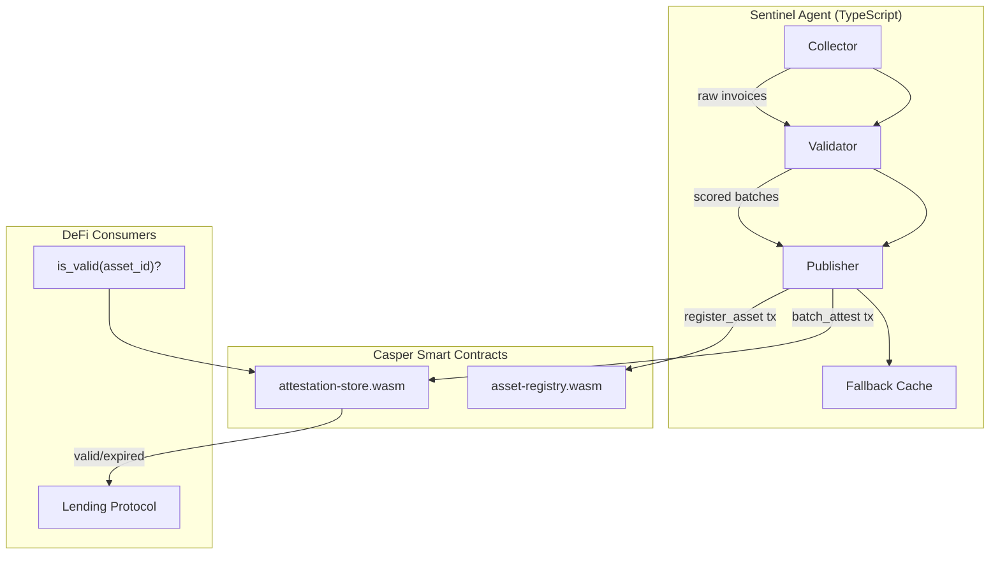

<a id="readme-top"></a>

<div align="center">

# RWA-Sentinel

**Autonomous AI oracle for real-world asset verification on Casper Network**

*Trust scores for off-chain assets, published on-chain as time-limited attestation NFTs.*

[](https://github.com/triumphkrug/RWA-Sentinel/actions/workflows/build.yml)
[](https://nodejs.org)
[-FF0000.svg?style=flat-square)](https://casper.network)
[](LICENSE)

[Landing Page](https://triumphkrug.github.io/RWA-Sentinel/) · [Architecture](docs/ARCHITECTURE.md) · [SDK Reference](docs/SDK.md) · [Changelog](CHANGELOG.md)

</div>

---

> [!IMPORTANT]
> **Deployed and verified.** Two smart contracts live on Casper testnet — asset-registry and attestation-store. The agent pipeline runs end-to-end: collect invoices → score with weighted factors → publish batch attestations on-chain.

---

<details>
<summary><strong>Table of Contents</strong></summary>

- [Abstract](#abstract)
- [Problem](#problem)
- [Solution — What RWA-Sentinel Does Differently](#solution--what-rwa-sentinel-does-differently)
- [Pipeline Overview](#pipeline-overview)
- [Quickstart](#quickstart)
- [Architecture](#architecture)
- [Smart Contracts](#smart-contracts)
- [Scoring Model](#scoring-model)
- [Configuration](#configuration)
- [Testing](#testing)
- [Scope: Implemented vs Planned](#scope-implemented-vs-planned)
- [Prior Art](#prior-art)
- [SDK and MCP](#sdk-and-mcp)
- [Project Structure](#project-structure)
- [Author](#author)
- [License](#license)

</details>

---

## Abstract

RWA-Sentinel is a decentralized AI agent that bridges off-chain real-world assets — invoices, trade receivables, supply-chain documents — with on-chain trust attestations. It autonomously collects, validates, scores, and publishes asset data to Casper Network smart contracts, producing time-limited attestation NFTs that DeFi protocols can consume as verified data feeds.

The system addresses a specific gap in RWA tokenization: **the oracle problem for trust, not price.** Unlike Chainlink-style price-feed oracles, RWA-Sentinel attests to the *validity and trustworthiness* of underlying assets through multi-factor analysis. Each attestation carries an expiration timestamp; DeFi protocols can query whether it is still valid before allowing collateral operations.

[![][back-to-top]](#readme-top)

## Problem

Current RWA tokenization relies on centralized custodians or manual verification. Three structural issues persist:

| Issue | Impact |
|---|---|
| **Trust concentration** | A single entity decides which assets are valid. No independent verification path. |
| **Latency** | Manual review introduces hours-to-days delays between asset origination and on-chain availability. |
| **Opacity** | Verification criteria are opaque to token holders. There is no on-chain audit trail of *how* an asset was scored. |

These are not theoretical concerns. The collapse of several centralized RWA platforms in 2024–2025 (e.g., custodian fraud, stale attestation windows) demonstrates what happens when trust depends on a single point of failure.

## Solution — What RWA-Sentinel Does Differently

1. **Multi-factor scoring with transparent weights.** Every attestation decomposes into six independently auditable factors (issuer history, debtor rating, amount reasonableness, time validity, detail level, cross-reference). The weights and raw scores are hashed and stored on-chain as evidence — not just the pass/fail result.

2. **Time-limited attestation NFTs.** Attestations expire after a configurable validity window (default: 24h). There is no "attest once, trust forever" — DeFi contracts check `is_valid(asset_id)` before accepting collateral.

3. **Challenge-and-stake mechanism.** Any participant can challenge an attestation by submitting counter-evidence. Oracle operators must stake CSPR; misbehavior leads to slashing. This creates economic accountability absent from centralized custodians.

No comparable system on Casper (or other chains we reviewed) combines all three: transparent scoring + expiring attestations + challenge-with-stake.

[![][back-to-top]](#readme-top)

## Pipeline Overview

The agent operates as a four-stage pipeline:

```
External Data ──▶ Collector ──▶ Validator ──▶ Publisher ──▶ Casper Network
                     │              │              │
                  dedup +       scoring +      batch NFT
                  hashing     cross-ref        minting
                                               
                  ┌────────── Fallback ──────────┐
                  │   in-memory cache + staleness │
                  └──────────────────────────────┘
```

1. **Collector** — ingests invoice data, deduplicates via SHA-256 hashing, normalizes to a common schema.
2. **Validator** — scores each invoice against six weighted factors, produces a composite trust score `S ∈ [0, 100]`.
3. **Publisher** — batches invoices with `S ≥ threshold` into a single `batch_attest` transaction, minting a time-limited attestation NFT.
4. **Fallback** — caches recent scores for fast retrieval; detects data staleness and triggers re-scoring.

[![][back-to-top]](#readme-top)

## Quickstart

Runs in under 5 minutes. Demo mode generates synthetic invoices — no Casper node or API keys needed.

**Prerequisites:** Node.js ≥ 20, npm

```bash
git clone https://github.com/triumphkrug/RWA-Sentinel.git
cd RWA-Sentinel
npm install
cp .env.example .env
npm start
```

**Expected output:**

```
[sentinel] Starting with chain=casper-test, batch=10
[sentinel] Generated 10 demo invoices
[sentinel] Collected 10 unique invoices
[sentinel] Scored: 10/10 above threshold
[sentinel] Pipeline complete. Cache size: 10
```

**Docker alternative:**

```bash
docker-compose up
# Agent + dashboard at http://localhost:3000
```

> [!TIP]
> To connect to Casper testnet, update `NODE_URL` and `DEPLOYER_KEY_PATH` in `.env`. See [Configuration](#configuration) for all options.

[![][back-to-top]](#readme-top)

## Architecture



*Text description: The TypeScript agent collects invoices, scores them through a weighted validator, and publishes passing batches to two Casper contracts — asset-registry stores metadata, attestation-store holds scored attestations with expiration. Downstream DeFi protocols query attestation validity before accepting RWA collateral.*

Full architecture diagrams: [docs/ARCHITECTURE.md](docs/ARCHITECTURE.md)

[![][back-to-top]](#readme-top)

## Smart Contracts

Both deployed on Casper testnet.

### asset-registry

Contract hash: [`eac01f54...`](https://testnet.cspr.live/contract/eac01f54e99db58d328e672d2ce5c40a6677cab577cc2bc3b9f8bbe277bd48c3)

| Entry Point | Access | Description |
|---|---|---|
| `register_asset` | Owner only | Register a new RWA with type and metadata hash |
| `update_asset` | Owner only | Update asset metadata |
| `get_asset` | Public | Query asset record by ID |

### attestation-store

Contract hash: [`53c9e877...`](https://testnet.cspr.live/contract/53c9e87755a94e1b1efe38e23c83a50f6ffe77e200937dd0c1f923fe2976dce8)

| Entry Point | Access | Description |
|---|---|---|
| `batch_attest` | Oracle only | Submit a batch of scored attestations |
| `get_attestation` | Public | Query attestation by asset ID |
| `challenge` | Any (rate-limited, max 3) | Challenge attestation with counter-evidence |
| `stake_oracle` | Oracle | Stake CSPR as operator collateral |
| `slash_oracle` | Admin | Slash misbehaving oracle (min 1 mote) |
| `dao_invalidate` | Governance | DAO-initiated invalidation of challenged attestation |
| `invalidate_nft` | Admin | Revoke an attestation NFT by batch ID |

**Compile from source:**

```bash
cd contracts/asset-registry
cargo build --release --target wasm32-unknown-unknown --no-default-features

cd ../attestation-store
cargo build --release --target wasm32-unknown-unknown --no-default-features
```

Security audit: 18 findings addressed. Average risk score reduced from 4/10 to 2/10. Details in [docs/KNOWN_LIMITATIONS.md](docs/KNOWN_LIMITATIONS.md).

[![][back-to-top]](#readme-top)

## Scoring Model

The local scorer implements a weighted factor analysis model. Each factor independently evaluates the asset and produces a score in `[0, 100]`.

| Factor | Weight | What it measures |
|---|---|---|
| Issuer History | 25% | Track record of the invoicing entity |
| Debtor Rating | 20% | Payment reliability of the debtor |
| Amount Reasonableness | 15% | Whether the amount falls within expected bounds for the asset type |
| Time Validity | 15% | Freshness of issue date; proximity to due date |
| Detail Level | 10% | Completeness of line items and metadata |
| Cross-Reference | 15% | Corroboration against external data sources |

Composite trust score:

```
S = Σ(wᵢ × sᵢ) / Σ(wᵢ)
```

Assets with `S ≥ 65` (configurable) proceed to on-chain publication. The factors hash and evidence hash are both anchored on-chain:

- **Factors hash:** `SHA-256(factor_names ‖ scores ‖ weights)`
- **Evidence hash:** `SHA-256(raw_hash ‖ factors_hash)`

This provides an immutable audit trail without revealing sensitive asset data.

[![][back-to-top]](#readme-top)

## Configuration

All options set via environment variables (validated with [zod](https://zod.dev/)):

| Variable | Required | Default | Description |
|---|---|---|---|
| `NODE_URL` | No | `https://node.testnet.casper.network/rpc` | Casper node RPC |
| `CHAIN_NAME` | No | `casper-test` | Network identifier |
| `DEPLOYER_KEY_PATH` | No | `./keys/secret_key.pem` | Deployer secret key |
| `BATCH_SIZE` | No | `10` | Max attestations per batch |
| `CHALLENGE_RATE_LIMIT` | No | `3` | Max challenges per block |
| `NFT_VALIDITY_HOURS` | No | `24` | Attestation NFT lifetime |
| `STALE_THRESHOLD_MINUTES` | No | `30` | Data staleness threshold |
| `DASHBOARD_PORT` | No | `3000` | Dashboard HTTP port |

See `.env.example` for a copy-paste template.

[![][back-to-top]](#readme-top)

## Testing

23 Rust contract tests + 3 TypeScript test suites. All passing.

```bash
# TypeScript tests
npx jest --ci

# Contract tests
cd contracts/tests && cargo test --release
```

| Suite | Count | Scope |
|---|---|---|
| `invoiceCollector.test.ts` | Unit | Ingestion, dedup, hashing |
| `localScorer.test.ts` | Unit | Scoring factors, threshold logic |
| `fullPipeline.test.ts` | Integration | End-to-end collect → score → publish → cache |
| `integration_tests.rs` | 23 | Contract entry points, access control, staking |

CI runs on every push: TypeScript lint (ESLint + Prettier) → Jest → WASM build → cargo test.

[![][back-to-top]](#readme-top)

## Scope: Implemented vs Planned

| Component | Status | Evidence |
|---|---|---|
| Asset-registry contract | ✅ Deployed | [Testnet tx](https://testnet.cspr.live/deploy/e6be2486e09e8d8da2fd8728bed776848962080993ca1cd2a13b8f0b37e16d03) |
| Attestation-store contract | ✅ Deployed | [Testnet tx](https://testnet.cspr.live/deploy/fb3625c205b50ffde3eb3dea2600ac1cbf5cd78de01018f0032d4ec53f18ebf0) |
| Four-stage agent pipeline | ✅ Working | Demo mode + test suite |
| Multi-factor scoring (6 factors) | ✅ Working | Unit + integration tests |
| Challenge-and-stake mechanism | ✅ On-chain | Rate-limited, min slash enforced |
| Time-limited attestation NFTs | ✅ On-chain | `batch_attest` + `invalidate_nft` |
| TypeScript SDK | ✅ Available | `sdk/index.ts` |
| MCP server (5 tools) | ✅ Available | `sdk/mcp.ts` |
| Dashboard | ⚠️ Scaffold | UI shell, full implementation planned |
| Multi-asset-class support | 🗺 Planned | Currently invoices only |
| Mainnet deployment | 🗺 Planned | Pending external audit |
| Real-time external data feeds | 🗺 Planned | Currently uses synthetic/demo data |

[![][back-to-top]](#readme-top)

## Prior Art

| | RWA-Sentinel | Chainlink (price feeds) | Centrifuge | Manual custodian |
|---|---|---|---|---|
| Oracle type | Trust attestation | Price feed | Document verification | Human review |
| Scoring transparency | ✅ On-chain factor hashes | ❌ Aggregated, opaque | ⚠️ Partial | ❌ None |
| Attestation expiry | ✅ Configurable TTL | ✅ Heartbeat | ❌ Permanent | ❌ N/A |
| Challenge mechanism | ✅ Stake + slash | ❌ None | ⚠️ Governance only | ❌ None |
| Casper-native | ✅ | ❌ | ❌ | — |
| *Where they're stronger* | — | ✅ Battle-tested infra, wide oracle network | ✅ Mature document protocol, real TVL | ✅ Legal enforceability |

[![][back-to-top]](#readme-top)

## SDK and MCP

**TypeScript SDK** — typed client for the Sentinel agent API:

```typescript
import { SentinelClient } from './sdk';

const client = new SentinelClient('http://localhost:3000');
const attestation = await client.getAttestation('asset-001');
```

**MCP Server** — 5 tools over stdio JSON-RPC:

```bash
npx ts-node sdk/mcp.ts
```

Full reference: [docs/SDK.md](docs/SDK.md)

## Project Structure

```
RWA-Sentinel/
├── agent/src/
│   ├── collector/          # Invoice ingestion and dedup
│   ├── validator/          # Scoring engine, cross-reference checks
│   ├── publisher/          # Casper batch submission, NFT minting
│   ├── fallback/           # In-memory cache, staleness detection
│   ├── config.ts           # Zod-validated configuration
│   └── index.ts            # Pipeline entry point
├── contracts/
│   ├── asset-registry/     # RWA registration (Rust/WASM)
│   └── attestation-store/  # Attestation, staking, DAO (Rust/WASM)
├── sdk/                    # TypeScript SDK + MCP server
├── dashboard/              # Monitoring UI
├── tests/                  # Unit + integration tests
├── docs/                   # Architecture, SDK docs, limitations
├── landing/                # Project landing page
├── .github/workflows/      # CI pipeline
└── docker-compose.yaml
```

## Author

**triumphkrug** — architecture, contracts, agent pipeline ([GitHub](https://github.com/triumphkrug))

Questions or feedback: [open an issue](https://github.com/triumphkrug/RWA-Sentinel/issues)

---

## License

Licensed under the [Apache License, Version 2.0](LICENSE).

**Security:** only testnet keys are used. Never commit deployer secret keys to the repository. See [docs/KNOWN_LIMITATIONS.md](docs/KNOWN_LIMITATIONS.md) for the full risk assessment.

*Last verified against commit `486374d`, 2026-06-29.*

[back-to-top]: https://img.shields.io/badge/-BACK_TO_TOP-151515?style=flat-square
